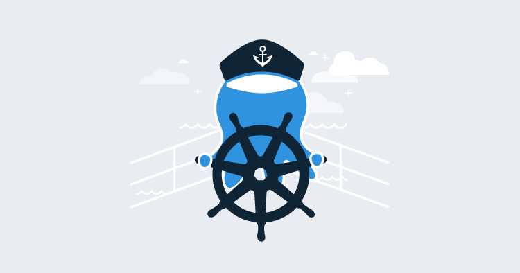

# Octopus Deploy Helm charts

This repository contains the [Helm](https://helm.sh) charts supported by [Octopus Deploy](https://octopus.com).

-   [Octopus Deploy](https://github.com/OctopusDeploy/helm-charts/tree/main/charts/octopus-deploy) - Self-host the Octopus Deploy server on your own Kubernetes cluster.
-   [Kubernetes Agent](https://github.com/OctopusDeploy/helm-charts/tree/main/charts/kubernetes-agent) - The agent which allows Octopus to run workloads on your Kubernetes clusters.

Releases are managed by [release-please](https://github.com/googleapis/release-please). Pull request titles must follow [Conventional Commits](https://www.conventionalcommits.org/), as the squashed commit message is used to decide the next chart version and to write the changelog:

-   `fix: ...` releases a patch version
-   `feat: ...` releases a minor version
-   `feat!: ...` (or a `BREAKING CHANGE:` footer) releases a major version
-   `chore: ...`, `docs: ...`, `ci: ...`, `test: ...` etc. do not trigger a release

The description should be customer facing, as it appears in the chart's `CHANGELOG.md`. Changes are attributed to a chart based on the files changed under `charts/<chart>`.

When releasable changes are merged, release-please opens (or updates) a release pull request. Merging it tags the release and publishes the affected charts.
